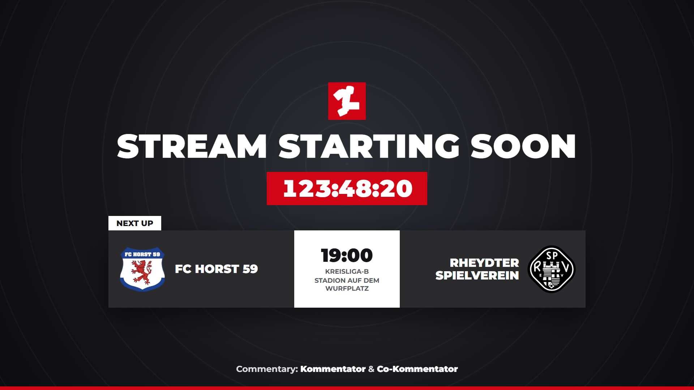
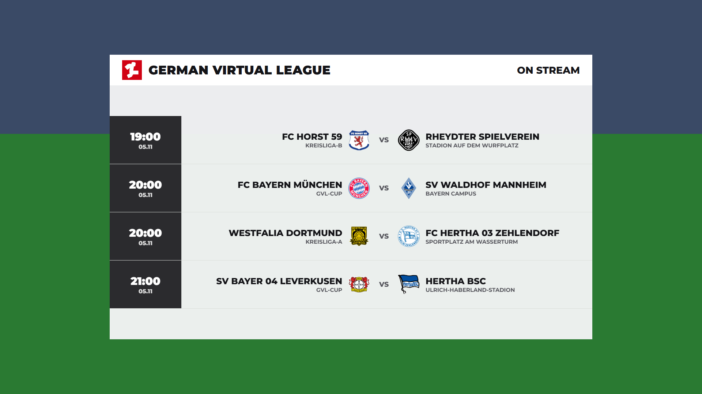
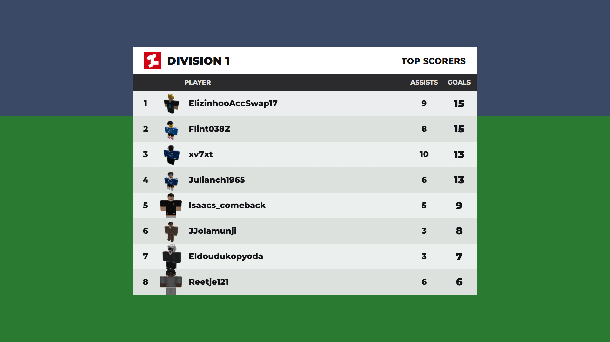
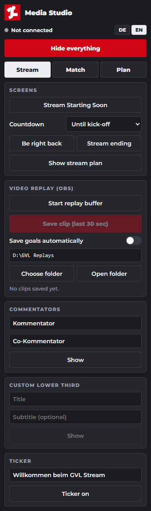

<p align="center">
  
</p>

<h1 align="center">GVL Media Studio</h1>

<p align="center">
  Professional live graphics for Roblox football in OBS.<br>
  Developed by <a href="https://github.com/hamterfreund08">hamterfreund08</a> for the German Virtual League.
</p>

<p align="center">
  <a href="README.md">Deutsch</a> | <b>English</b>
</p>

<p align="center">
  
</p>

## What is it?

GVL Media Studio connects a running GVL match in Roblox to OBS. Lineups, goals, cards, substitutions and tables come straight from the game and appear as graphics on your stream. You control everything from a panel inside OBS.

You do not need port forwarding and you never share an IP address. The connection runs through a Cloudflare tunnel that the panel creates with one click.

## Features

**Match graphics**
- Match preview with large club crests, form and kick-off time
- Animated lineups for both teams, including substitutes and manager
- League table with live calculation during the match
- Score with goalscorers, matchday overview and top scorers
- Goal, card and substitution graphics, automatic or manual
- Match bar, officials, managers, players and Man of the Match

**Stream production**
- Stream Starting Soon with countdown and the next match
- Be Right Back and Stream Ending screens
- Stream plan: choose the upcoming GVL matches you are streaming
- Commentator graphic and custom lower thirds
- Ticker with your own text, today's results or a team's lineup

**Replays**
- 3D replay in the game that only you see and OBS broadcasts
- Video replay using the OBS Replay Buffer, normal speed or slow motion
- Optionally save goals as clips automatically

**Panel**
- Switch the language between German and English
- Settings and your stream plan are saved

<p align="center">
  
  
</p>

<p align="center">
  
</p>

## Requirements

| | |
|---|---|
| **System** | Windows 10 or 11, 64-bit |
| **OBS Studio** | Current version, tested with 32.1.2 |
| **Roblox** | You are on the `Media` team in the GVL game |
| **Internet** | A stable connection for the Cloudflare tunnel |

You do not need Python or any other software for normal use.

## Installation

> **Important:** Do **not** use the green **Code** button. It does not include the program. You need the `GVL-Media-Studio.zip` file from Releases.

1. Download the latest [`GVL-Media-Studio.zip`](https://github.com/hamterfreund08/gvl-media-studio/releases/latest/download/GVL-Media-Studio.zip).
2. Extract the whole ZIP into a folder. Do not run anything from inside the ZIP window.
3. Close OBS.
4. Run `GVL Media Studio.exe` in the extracted folder and click **Install** in the window.
5. Open OBS and enable **GVL Media Studio** in the **Docks** menu.

The panel is now available and the `GVL Broadcast Overlay` source is in your scenes. From now on the program starts and stops together with OBS.

> Windows SmartScreen may warn you on the first start because the program is not signed. Click **More info** and **Run anyway**. Only download the file from this repository.

If your antivirus blocks the copy, the program stays in the extracted folder and the confirmation tells you so. Do not move or delete that folder in that case.

### Updating

When a new version is out, the panel shows a notice at the top. **Update now** downloads it from GitHub and restarts the panel. If the OBS script changes, the panel asks you to restart OBS once. Updating is not possible while the tunnel is running.

You can also click **Open app** in the panel, close OBS and choose **Update** in the window. This works from version 1.9.0 on. Update older versions once by hand: close OBS, extract the new ZIP, run `GVL Media Studio.exe` there and click **Update**. Your settings and stream plan are kept.

**Repair** in the same window fixes a broken setup, for example when the panel is missing in OBS.

### Uninstalling

Close OBS, run `GVL Media Studio.exe` (or click **Open app** in the panel) and click **Uninstall**. Your settings are stored in `%APPDATA%\GVLMediaStudio`, and you can delete that folder yourself if you want to.

## Connecting to a match

1. Open the **Match** tab in the panel and click **Start connection**.
2. Click **Copy link**.
3. Join the `Media` team in the game. The **Media Studio** window appears at the bottom right.
4. Paste the link and click **Connect**.

The panel now shows **Connected** and all match graphics are ready. The schedule, table and top scorers also come from the game, so the **Plan** tab fills up after your first connection and remembers the data afterwards.

The link stays valid while the tunnel is running. If you restart the tunnel, click **Disconnect** in the game and paste the new link. Do not share the link with anyone.

## Running a stream

| When | What to do |
|---|---|
| Before the stream | Choose your matches under **Plan** and enter the commentators under **Stream** |
| Stream starts | Show **Stream Starting Soon** |
| Before kick-off | Match preview, home and away lineups, table |
| During the match | Goals, cards and substitutions run automatically, plus replays when you want them |
| Half time | Score, table, top scorers, **Be right back** |
| Full time | Score, Man of the Match, table, **Stream ending** |

**Hide everything** clears the screen at any time.

## Scenes and transitions

The **Stream** tab lists all OBS scenes under **Scenes**. A click switches to that scene using the transition selected above:

- **GVL Swipe:** White, red and dark bands sweep diagonally across the screen with the GVL logo in the middle.
- **GVL Swipe Fast:** The same sweep, shorter, for quick changes.
- **Team colours:** Bands in both teams' colours with both crests in the middle. Without a connected match it falls back to GVL Swipe.
- **Hard cut:** Direct switch without animation.

The scene switches while the screen is fully covered, so viewers never see the cut. The selected transition is also used for Stream Starting Soon, Be Right Back and Stream Ending. **Test transition** plays it once without switching scenes.

The overlay source has to be on top in every scene. When switching from the dock, the program moves it there itself. After updating to 1.12.0 the scenes only appear once OBS has been restarted.

**In OBS itself:** **GVL Swipe** and **GVL Swipe Fast** are also listed under **Scene Transitions** as stinger videos. Pick one and it plays on every scene change, including clicks on a scene, Studio Mode and hotkeys. Team colours are only available in the panel because the videos have fixed colours. After updating from the panel, both transitions appear once OBS has been closed and opened again.

## Social media

Enter your Instagram, Twitch, TikTok and YouTube channels under **Social media** in the **Stream** tab. A missing `@` is added automatically.

- **Show** next to a channel: a lower third for just that channel with a large logo and Follow us on ….
- **Show all:** Follow Us with all channels and their logos for 9 seconds.
- **Corner on:** One channel at a time at the bottom left, switching every 7 seconds. The corner hides while a lower third or a full-screen graphic is shown.
- Stream Starting Soon, Be Right Back and Stream Ending list the channels at the bottom automatically.

## Replays

**In-game replay** uses the Roblox 3D replay and only runs on your screen. Start it from the panel, from the Media window in the game, or with the `F8` key. It keeps up to 30 seconds. Only players who were on the pitch appear in the replay.

**Video replay** uses the OBS Replay Buffer and shows exactly what your stream showed.

1. Click **Start replay buffer**.
2. After a moment you want to keep, click **Save clip**.
3. Play the clip with **Normal** or **Slow motion**.

The buffer uses extra CPU, so only turn it on while streaming. Use **Choose folder** to decide where clips are saved. A drive with plenty of free space works best, because clips are not deleted automatically.

## Troubleshooting

| Problem | Solution |
|---|---|
| Panel is missing in OBS | Open the **Docks** menu and enable **GVL Media Studio** |
| "File not found" in the panel | Close OBS, download the latest ZIP, extract it and run `GVL Media Studio.exe` there |
| "Service not reachable" | Restart OBS |
| Graphics do not appear | Check that `GVL Broadcast Overlay` is at the top of the scene and visible |
| Media window missing in the game | You must be on the `Media` team |
| "OBS not reachable" in the game | Restart the tunnel in the panel and paste the new link |
| "Disconnect first" in the game | Click **Disconnect** first, then paste the new link |
| Plan stays empty | Connect to a match once |
| Table is greyed out | The competition has no table, for example a cup |
| Replay shows no players | Nobody from Home, Away or Referee was on the pitch |

Error log: `%APPDATA%\GVLMediaStudio\media_studio.log`

## Security

- The package contains no credentials, API keys or sheet addresses.
- The program can only be reached from your own PC.
- Only the data input is reachable through the tunnel, protected by a random secret in the link.
- The panel and overlay cannot be reached from outside.
- The game only accepts links from `trycloudflare.com`.

## Building from source

This is only needed for developers. You need Windows and Python 3.13.

```powershell
git clone https://github.com/hamterfreund08/gvl-media-studio.git
cd gvl-media-studio
powershell -ExecutionPolicy Bypass -File build.ps1
```

The script downloads `cloudflared` automatically and creates the finished package at `dist\GVL-Media-Studio.zip`.

### Project layout

| Path | Contents |
|---|---|
| `media_studio.py` | Local service for panel, overlay, tunnel and replays |
| `installer.py` | Setup and removal in OBS |
| `web/` | Panel (`dock.html`) and overlay (`overlay.html`) |
| `obs/` | OBS script and panel start page |
| `build.ps1` | Builds the package |
| `updater.py`, `app.py` | Updates from GitHub and the setup window |
| `tools/render_stingers.py` | Renders the stinger videos into `obs/stingers`, only needed after changing the stinger (needs `playwright`, `imageio-ffmpeg` and Chrome) |

The part inside the Roblox game belongs to the GVL system and is not included in this repository.

## License

Copyright (c) 2026 hamterfreund08. All rights reserved.

Third-party components are covered by their own licenses, see [THIRD_PARTY_NOTICES.md](THIRD_PARTY_NOTICES.md). Club crests and brand names belong to their respective owners.
