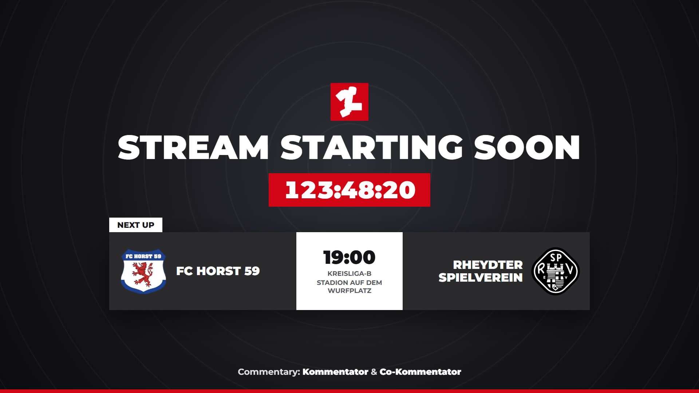
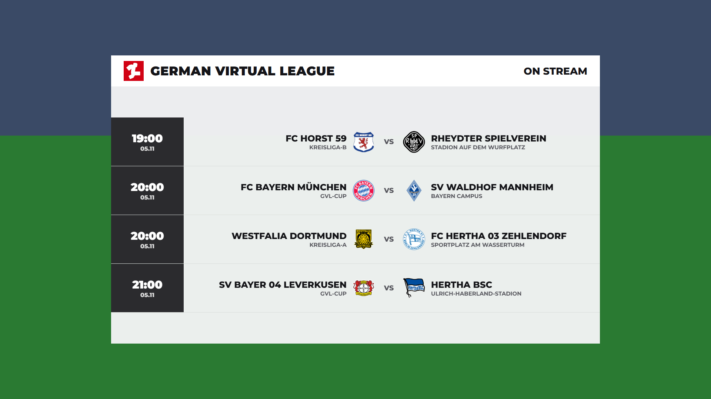
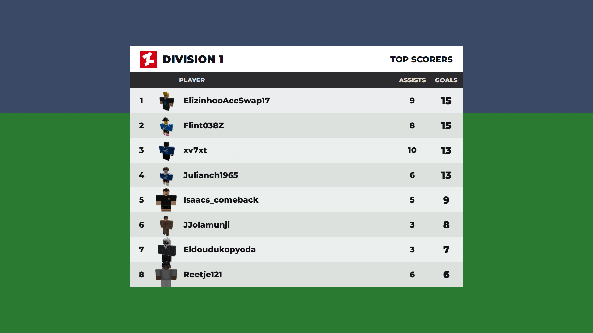
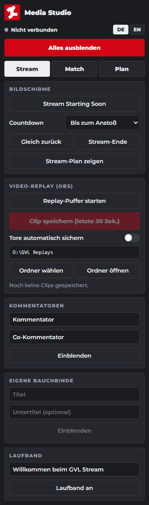

<p align="center">
  
</p>

<h1 align="center">GVL Media Studio</h1>

<p align="center">
  Professionelle Live-Grafiken für Roblox-Fußball in OBS.<br>
  Entwickelt von <a href="https://github.com/hamterfreund08">hamterfreund08</a> für die German Virtual League.
</p>

<p align="center">
  <b>Deutsch</b> | <a href="README.en.md">English</a>
</p>

<p align="center">
  
</p>

## Was ist das?

GVL Media Studio verbindet ein laufendes GVL-Spiel in Roblox mit OBS. Aufstellungen, Tore, Karten, Wechsel und Tabellen kommen direkt aus dem Spiel und erscheinen als Grafiken im Stream. Bedient wird alles über ein Panel in OBS.

Du brauchst keine Portfreigabe und musst keine IP-Adresse teilen. Die Verbindung läuft über einen Cloudflare-Tunnel, den das Panel per Klick aufbaut.

## Funktionen

**Match-Grafiken**
- Match-Vorschau mit großen Vereinswappen, Form und Anstoßzeit
- Animierte Aufstellung für beide Teams inklusive Bank und Trainer
- Tabelle mit Live-Berechnung während des Spiels
- Spielstand mit Torschützen, Spieltag und Torjägerliste
- Einblendungen für Tore, Karten und Wechsel, automatisch oder per Hand
- Match-Leiste, Schiedsrichter, Trainer, Spieler und Man of the Match

**Stream-Produktion**
- Stream Starting Soon mit Countdown und dem nächsten Spiel
- Gleich zurück und Stream-Ende
- Stream-Plan: Wähle die kommenden GVL-Spiele aus, die du streamst
- Kommentatoren-Einblendung und eigene Bauchbinden
- Laufband mit eigenem Text, heutigen Ergebnissen oder der Aufstellung eines Teams

**Replays**
- 3D-Replay im Spiel, das nur du siehst und das OBS überträgt
- Video-Replay über den OBS Replay Buffer, normal oder in Zeitlupe
- Tore auf Wunsch automatisch als Clip sichern

**Panel**
- Sprache auf Deutsch oder Englisch umschaltbar
- Einstellungen und Stream-Plan bleiben gespeichert

<p align="center">
  
  
</p>

<p align="center">
  
</p>

## Voraussetzungen

| | |
|---|---|
| **System** | Windows 10 oder 11, 64 Bit |
| **OBS Studio** | Aktuelle Version, getestet mit 32.1.2 |
| **Roblox** | Du bist im GVL-Spiel im Team `Media` |
| **Internet** | Stabile Verbindung für den Cloudflare-Tunnel |

Python oder andere Programme musst du für die normale Nutzung nicht installieren.

## Installation

> **Wichtig:** Lade **nicht** den grünen **Code**-Knopf herunter. Darin fehlt das Programm. Du brauchst die Datei `GVL-Media-Studio.zip` aus den Releases.

1. Lade die aktuelle [`GVL-Media-Studio.zip`](https://github.com/hamterfreund08/gvl-media-studio/releases/latest/download/GVL-Media-Studio.zip) herunter.
2. Entpacke die ZIP komplett in einen Ordner. Starte nichts direkt aus dem ZIP-Fenster.
3. Schließe OBS.
4. Starte im entpackten Ordner `GVL Media Studio.exe` und klicke im Fenster auf **Installieren**.
5. Öffne OBS und schalte im Menü **Docks** den Eintrag **GVL Media Studio** ein.

Das Panel ist jetzt da, und die Quelle `GVL Broadcast Overlay` liegt in deinen Szenen. Das Programm startet und beendet sich ab jetzt automatisch mit OBS.

> Windows SmartScreen kann beim ersten Start warnen, weil das Programm nicht signiert ist. Klicke dann auf **Weitere Informationen** und **Trotzdem ausführen**. Lade die Datei nur aus diesem Repository.

Blockiert der Virenschutz das Kopieren, bleibt das Programm im entpackten Ordner. Die Bestätigung weist darauf hin. Diesen Ordner dann nicht verschieben oder löschen.

### Aktualisieren

Gibt es eine neue Version, zeigt das Panel oben einen Hinweis. Ein Klick auf **Jetzt aktualisieren** lädt sie von GitHub und startet das Panel neu. Ändert sich dabei das OBS-Skript, steht im Panel, dass OBS einmal neu gestartet werden muss. Während der Tunnel läuft, geht das Update nicht.

Alternativ im Panel auf **App öffnen** klicken, OBS schließen und im Fenster **Aktualisieren** wählen. Ab Version 1.9.0 geht das so, ältere Versionen einmal von Hand aktualisieren: OBS schließen, die neue ZIP entpacken, dort `GVL Media Studio.exe` starten und auf **Aktualisieren** klicken. Einstellungen und Stream-Plan bleiben erhalten.

Im selben Fenster repariert **Reparieren** eine kaputte Einrichtung, zum Beispiel wenn das Panel in OBS fehlt.

### Deinstallieren

OBS schließen, `GVL Media Studio.exe` starten (oder im Panel **App öffnen**) und auf **Deinstallieren** klicken. Deine Einstellungen liegen in `%APPDATA%\GVLMediaStudio`. Diesen Ordner kannst du bei Bedarf selbst löschen.

## Mit einem Spiel verbinden

1. Öffne im Panel den Reiter **Match** und klicke auf **Verbindung starten**.
2. Klicke auf **Link kopieren**.
3. Gehe im Spiel ins Team `Media`. Unten rechts erscheint das Fenster **Media Studio**.
4. Füge den Link ein und klicke auf **Connect**.

Das Panel zeigt dann **Verbunden**, und alle Match-Grafiken stehen bereit. Spielplan, Tabelle und Torjäger kommen ebenfalls vom Spiel. Der Reiter **Plan** füllt sich deshalb erst nach der ersten Verbindung und merkt sich die Daten danach.

Der Link gilt, solange der Tunnel läuft. Startest du den Tunnel neu, klickst du im Spiel auf **Disconnect** und fügst den neuen Link ein. Teile den Link mit niemandem.

## Ablauf eines Streams

| Wann | Was du machst |
|---|---|
| Vor dem Stream | Unter **Plan** deine Spiele wählen, unter **Stream** die Kommentatoren eintragen |
| Stream beginnt | **Stream Starting Soon** einblenden |
| Vor Anstoß | Match-Vorschau, Aufstellung Heim und Gast, Tabelle |
| Während des Spiels | Tore, Karten und Wechsel laufen automatisch, dazu Replays nach Bedarf |
| Halbzeit | Spielstand, Tabelle, Torjäger, **Gleich zurück** |
| Abpfiff | Spielstand, Man of the Match, Tabelle, **Stream-Ende** |

Mit **Alles ausblenden** räumst du das Bild jederzeit frei.

## Szenen und Übergänge

Im Reiter **Stream** stehen unter **Szenen** alle Szenen aus OBS. Ein Klick wechselt dorthin, mit dem Übergang, der darüber ausgewählt ist:

- **GVL Swipe:** Weiße, rote und dunkle Bänder wischen schräg durchs Bild, in der Mitte das GVL-Logo.
- **GVL Swipe Fast:** Derselbe Wischer, kürzer, für schnelle Wechsel.
- **Teamfarben:** Bänder in den Farben beider Teams, in der Mitte die Wappen. Ohne verbundenes Spiel wird es GVL Swipe.
- **Harter Schnitt:** Direkter Wechsel ohne Animation.

Gewechselt wird, während das Bild ganz bedeckt ist. Der Zuschauer sieht keinen Schnitt. Der ausgewählte Übergang gilt auch für Stream Starting Soon, Gleich zurück und Stream-Ende. Mit **Übergang testen** läuft er einmal ohne Szenenwechsel.

Die Overlay-Quelle muss in jeder Szene ganz oben liegen. Beim Wechsel über das Dock legt das Programm sie selbst dorthin. Nach dem Update auf 1.12.0 erscheinen die Szenen erst, wenn OBS einmal neu gestartet wurde.

**In OBS selbst:** Unter **Szenenübergänge** stehen außerdem **GVL Swipe** und **GVL Swipe Fast** als Stinger-Videos. Wählst du einen davon aus, läuft er bei jedem Szenenwechsel, auch beim Klick auf eine Szene, im Studio-Modus und mit Hotkeys. Teamfarben gibt es nur im Panel, weil die Videos feste Farben haben. Nach einem Update aus dem Panel heraus erscheinen die beiden Übergänge, sobald OBS einmal geschlossen und wieder geöffnet wurde.

## Social Media

Im Reiter **Stream** unter **Social Media** trägst du die Kanäle für Discord, Instagram, Twitch, TikTok und YouTube ein. Ohne `@` wird es automatisch ergänzt, außer bei Links wie `discord.gg/gvl`. Discord ist mit `discord.gg/gvl` vorausgefüllt und erscheint damit immer in der Ecke.

- **Zeigen** neben einem Kanal: Bauchbinde nur für diesen Kanal, mit großem Logo und „Follow us on …“.
- **Alle zeigen:** „Follow Us“ mit allen Kanälen und ihren Logos für 9 Sekunden.
- **Ecke an:** Unten links erscheint immer ein Kanal und wechselt alle 7 Sekunden zum nächsten. Während einer Bauchbinde oder eines Vollbilds blendet sich die Ecke kurz aus.
- Auf Stream Starting Soon, Gleich zurück und Stream-Ende stehen die Kanäle automatisch unten.

## Replays

**Replay im Spiel** nutzt das 3D-Replay von Roblox und läuft nur auf deinem Bildschirm. Du startest es im Panel, im Media-Fenster im Spiel oder mit der Taste `F8`. Es speichert bis zu 30 Sekunden. Im Replay erscheinen nur Spieler, die auf dem Platz waren.

**Video-Replay** nutzt den OBS Replay Buffer und zeigt genau das Bild deines Streams.

1. Klicke auf **Replay-Puffer starten**.
2. Klicke nach einer Szene auf **Clip speichern**.
3. Spiele den Clip mit **Normal** oder **Zeitlupe** ab.

Der Puffer braucht zusätzliche CPU-Leistung. Schalte ihn nur beim Streamen ein. Mit **Ordner wählen** legst du fest, wo Clips landen. Am besten ist ein Laufwerk mit viel freiem Platz, denn Clips werden nicht automatisch gelöscht.

## Häufige Probleme

| Problem | Lösung |
|---|---|
| Panel fehlt in OBS | Menü **Docks** öffnen und **GVL Media Studio** einschalten |
| „Datei nicht gefunden“ im Panel | OBS schließen, aktuelle ZIP laden, entpacken und dort `GVL Media Studio.exe` starten |
| „Dienst nicht erreichbar“ | OBS neu starten |
| Grafiken erscheinen nicht | Prüfen, ob `GVL Broadcast Overlay` in der Szene oben liegt und sichtbar ist |
| Media-Fenster fehlt im Spiel | Du musst im Team `Media` sein |
| „OBS not reachable“ im Spiel | Tunnel im Panel neu starten und den neuen Link einfügen |
| „Disconnect first“ im Spiel | Erst **Disconnect** klicken, dann den neuen Link einfügen |
| Plan bleibt leer | Einmal mit einem Spiel verbinden |
| Tabelle ist ausgegraut | Der Wettbewerb hat keine Tabelle, zum Beispiel ein Pokal |
| Replay ohne Spieler | Es war niemand aus Home, Away oder Referee auf dem Platz |

Fehlerprotokoll: `%APPDATA%\GVLMediaStudio\media_studio.log`

## Sicherheit

- Das Paket enthält keine Zugangsdaten, API-Schlüssel oder Sheet-Adressen.
- Das Programm ist nur auf deinem eigenen PC erreichbar.
- Über den Tunnel ist nur der Dateneingang erreichbar, geschützt durch ein zufälliges Geheimnis im Link.
- Panel und Overlay sind von außen nicht erreichbar.
- Das Spiel akzeptiert nur Links von `trycloudflare.com`.

## Selbst bauen

Nur für Entwickler nötig. Du brauchst Windows und Python 3.13.

```powershell
git clone https://github.com/hamterfreund08/gvl-media-studio.git
cd gvl-media-studio
powershell -ExecutionPolicy Bypass -File build.ps1
```

Das Skript lädt `cloudflared` automatisch herunter und legt das fertige Paket unter `dist\GVL-Media-Studio.zip` ab.

### Aufbau

| Pfad | Inhalt |
|---|---|
| `media_studio.py` | Lokaler Dienst für Panel, Overlay, Tunnel und Replays |
| `installer.py` | Einrichtung und Entfernung in OBS |
| `web/` | Panel (`dock.html`) und Overlay (`overlay.html`) |
| `obs/` | OBS-Skript und Startseite des Panels |
| `build.ps1` | Baut das Paket |
| `updater.py`, `app.py` | Updates über GitHub und das Fenster zum Installieren |
| `tools/render_stingers.py` | Rendert die Stinger-Videos nach `obs/stingers`, nur nach Änderungen am Stinger nötig (braucht `playwright`, `imageio-ffmpeg` und Chrome) |

Der Teil im Roblox-Spiel gehört zum GVL-System und ist nicht Teil dieses Repositorys.

## Lizenz

Copyright (c) 2026 hamterfreund08. Alle Rechte vorbehalten.

Enthaltene Komponenten von Drittanbietern stehen unter ihren eigenen Lizenzen, siehe [THIRD_PARTY_NOTICES.md](THIRD_PARTY_NOTICES.md). Vereinswappen und Markennamen gehören ihren jeweiligen Inhabern.
